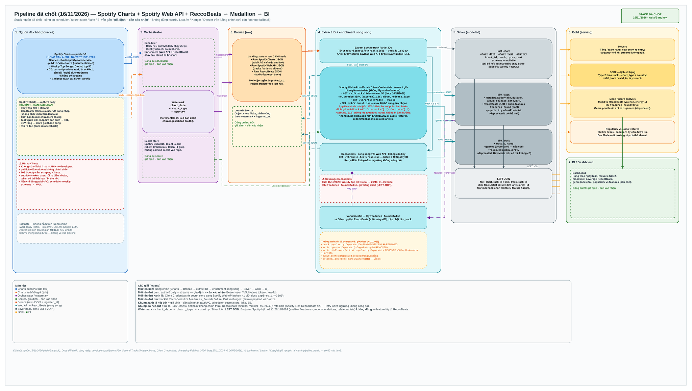

# Spotify Charts → Web API → ReccoBeats Pipeline

**Status:** Bronze Stage 4 locked + **Silver C10** (`build-silver`) + **Gold C11** (`build-gold`: coverage / movers / mood / popularity skip-safe; SCD2 deferred). SoR = Postgres `music.*`. Backfill / `run --offline` still open. `run` stays Bronze-only (SQ-11 / GQ-8). Spotify = single `/{id}` (Q-D=2).  
**Audience:** Learning / portfolio demo — not legal advice, not production SaaS.  
**Gaps checklist:** [`docs/CHECKLIST_SPEC_GAPS.md`](docs/CHECKLIST_SPEC_GAPS.md)

Local **batch** data pipeline design that ingests Spotify chart rankings, enriches track/artist metadata via the Spotify Web API (Client Credentials), pulls audio-feature metrics from **ReccoBeats**, and lands data in a **Bronze → Silver → Gold** (medallion) layout.

> **Naming:** This folder is `spotify-pipeline`. The SPEC still refers to repo alias `spotify-data-pipeline` and Python package `spotify_pipeline` (planned).

## Why ReccoBeats?

New Spotify developer apps cannot use Audio Features / Audio Analysis ([Spotify blog, 27 Nov 2024](https://developer.spotify.com/blog/2024-11-27-changes-to-the-web-api)). ReccoBeats provides proprietary substitutes ([audio-features API](https://reccobeats.com/docs/apis/get-audio-features), [ToS](https://reccobeats.com/docs/documentation/terms-of-service)). Metrics are labeled `source=reccobeats` and are **not** claimed to equal historical Spotify Audio Features.

## Locked happy path

| Source | Role |
|--------|------|
| **Spotify Charts** (`charts-spotify-com-service`) | Ranking grain: `chart_date` × `chart_type` × `country` × track |
| **Spotify Web API** | Official track / artist / album metadata (no locked audio-features endpoints) |
| **ReccoBeats** | Audio features only (`danceability`, `energy`, `valence`, `tempo`, …) |

**Not** on the locked path (documented fallbacks only): kworb, Last.fm, Kaggle dumps, Deezer.

### Intended MVP (locked)

- Charts **`public/v0`** — weekly Global top 50 (unauthenticated); `streams = NULL`
- Bronze SoR = Postgres `music.raw_*` (+ optional FS dual-write under `data/bronze/`)
- Silver = Postgres `music.fact_chart` / `dim_*` / `bridge_*` via `build-silver` (LEFT JOIN + `features_found`)
- Gold = Postgres views + `build-gold` one-pass (coverage / movers / mood; popularity skip if null; formal SCD2 deferred)
- Spotify enrich = single `/{id}` (batch `?ids=` deferred)
- Bronze cycle: `run` (Bronze-only). Silver: `build-silver`. Gold: `build-gold` per watermark (not wired into `run`)
- Later: offline fixtures + C12 feature backfill + BI
- **Orchestration v2 (specced, not coded yet):** Airflow DAG `spotify_weekly` Option B — see [`docs/spec/v2/SPEC_V2.md`](docs/spec/v2/SPEC_V2.md). Soft wire `run`→Silver/Gold **superseded** by DAG. `run` stays Bronze-only.

Daily Top 200 + streams via Charts **`auth/v0`**, cloud warehouse, Prefect, and BI dashboards remain **out of MVP / undecided**. Airflow weekly path is **locked in SPEC v2** (not implemented yet).

## Architecture



Editable source: [`architecture/version_1/music-pipeline.drawio`](architecture/version_1/music-pipeline.drawio) · v2 diagram: [`architecture/version_2/`](architecture/version_2/) · Specs: [`docs/spec/SPEC.md`](docs/spec/SPEC.md) (v1) · [`docs/spec/v2/SPEC_V2.md`](docs/spec/v2/SPEC_V2.md) (orchestration)

```text
Charts public/v0 ──► Bronze ──► extract IDs ──┬──► Spotify Web API ──► dim_track / dim_artist
                     ▲                         │
                     │                         └──► ReccoBeats (?ids= ≤40) ──► dim_track.features_*
                     │
                     └── raw JSON retained
                                              fact_chart ──► LEFT JOIN ──► Gold (movers / mood / coverage)
```

## Core rules

1. **Never** call Spotify `/v1/audio-features`, `/v1/audio-analysis`, `/v1/recommendations`, or related-artists.
2. ReccoBeats: query `GET /v1/audio-features?ids=` only — **not** Spotify IDs in path `/:id` (4041). Batch **≤ 40** IDs (41+ → `4004`).
3. Missing ReccoBeats tracks → `features_found=false`; **keep** the chart row (Silver uses **LEFT JOIN** only).
4. Do **not** use ReccoBeats search to “repair” coverage (wrong remix risk).
5. Deprecated Spotify fields (`popularity`, `genres`, `followers`, …) are nullable; Gold degrades gracefully.
6. Secrets live in `.env` only — never commit tokens.

## Observed ReccoBeats coverage (16/11/2026)

Sample of 40 weekly Global track IDs → **26/40** matched. Top ranks **#1–#6** were missing (new-release lag). The pipeline must retain those ranks with `features_found=false` and report coverage explicitly.

## Stack (MVP)

| Layer | Choice |
|-------|--------|
| Language | Python 3.12+ |
| HTTP | `httpx` |
| Config | `pydantic-settings` + `.env` |
| Storage | Postgres `music.*` (SoR) + optional FS Bronze dual-write |
| CLI | `typer` |
| Tests | `pytest` (+ recorded fixtures later) |
| Packaging | `pip` + `venv` + `pyproject.toml` |

Layout: `src/spotify_pipeline/` with separated `clients/`, `models/`, `pipeline/` (layer packages), `state/`, `analytics/`. Silver + Gold builders live; `analytics/*` / backfill / offline still stub.

### Pipeline packages (`src/spotify_pipeline/pipeline/`)

| Path | Role |
|------|------|
| `bronze/` | C8 writers + C9 charts ingest + Bronze ID extract |
| `enrich/` | C9 Spotify + ReccoBeats enrich → Bronze |
| `silver/` | C10 fact/dims builders + LEFT JOIN helper |
| `gold/` | C11 readers + SQL templates + `build_gold` |
| `backfill/` | C12 ReccoBeats gap backfill (stub) |
| `run.py` | C14 Bronze-cycle orchestration |

## SQL layout (`docs/sql/`)

| Path | Role |
|------|------|
| [`docs/sql/init/music_schema.sql`](docs/sql/init/music_schema.sql) | DDL bootstrap: schema `music` + Bronze/Silver tables + Gold VIEWs |
| [`docs/sql/silver/`](docs/sql/silver/) | Silver runtime templates (e.g. BR-6 `fact_chart` LEFT JOIN `dim_track`) |
| [`docs/sql/gold/`](docs/sql/gold/) | Gold runtime templates (`gold_queries.sql`) + smoke checks (`gold_check.sql`) |

Apply DDL once (idempotent):

```bash
python scripts/ddl/apply_music_ddl.py
# or: python scripts/ddl/apply_music_ddl.py docs/sql/init/music_schema.sql
```

## Scripts layout

| Folder | Scripts |
|--------|---------|
| `scripts/check/` | smoke probes (`check_spotify`, `check_spotify_user`, `check_supabase`, `check_reccobeats`) |
| `scripts/bronze/` | `load_raw_*` / `clear_raw_*` |
| `scripts/ddl/` | `apply_music_ddl` (default → `docs/sql/init/music_schema.sql`) |
| `scripts/auth/` | `spotify_login` |

**Bronze store of record:** Postgres `music.raw_*` (jsonb + `ingested_at`) via `pipeline/bronze/` writers (C8). Optional dual-write JSON under `data/bronze/` (Assumptions #4) with envelope `ingested_at` — FS does not replace SoR.

For long `load_raw_*` loops, set `SUPABASE_DB_URL` to Session pooler **`…pooler.supabase.com:5432`**. Transaction pooler **:6543** can raise pg8000 `08P01` / `26000` prepared-statement errors; Direct `db.<ref>:5432` may time out on some networks.

## Connect DB supabase
```bash
source .venv/bin/activate       # macOS / Linux
# source .venv/Scripts/activate # Windows Git Bash
python scripts/check/check_supabase.py
```

## Migrate music SQL → Supabase (schema `music` only)
```bash
# Requires SUPABASE_DB_URL in .env (Dashboard → Database → Connect)
python scripts/ddl/apply_music_ddl.py
python scripts/ddl/apply_music_ddl.py docs/sql/init/music_schema.sql   # optional path
```
Does **not** touch weather tables. Idempotent (`IF NOT EXISTS`).

## Pipeline entrypoint (SPEC) — watermark + Bronze Stage 4
```bash
# Watermark = (chart_date, chart_type, country).
# ingest-charts: chart_date must match live Charts public/v0.
# enrich / run: IDs come from Bronze raw_charts (extract once), not live Charts re-fetch.

# One Bronze cycle: ingest → extract IDs once → Spotify + ReccoBeats (logical fan-out)
python -m spotify_pipeline run \
  --chart-date 2026-11-12 \
  --chart-type weekly_top_songs \
  --country global

# Or stages separately (each enrich extracts from Bronze unless already ingested)
python -m spotify_pipeline ingest-charts \
  --chart-date 2026-11-12 \
  --chart-type weekly_top_songs \
  --country global

python -m spotify_pipeline enrich-spotify \
  --chart-date 2026-11-12 \
  --chart-type weekly_top_songs \
  --country global

python -m spotify_pipeline enrich-reccobeats \
  --chart-date 2026-11-12 \
  --chart-type weekly_top_songs \
  --country global

# Skip re-ingest when Bronze charts already exist:
python -m spotify_pipeline run --chart-date 2026-11-12 --skip-ingest
```
`scripts/bronze/*` remain smoke helpers only (not watermark stages). `run` stays Bronze-only (does not call Silver/Gold).

## Silver layer (C10)

Reads **only** Bronze `music.raw_*` — no HTTP. One-pass upsert into curated tables.

| Object | Role |
|--------|------|
| `music.fact_chart` | Chart ranks (`rank`, `prev_rank`, `streams` nullable on `public/v0`) |
| `music.dim_track` | Track metadata + ReccoBeats features + `features_found` |
| `music.dim_artist` / `bridge_track_artist` | Artists + track↔artist links |
| Runtime SQL | [`docs/sql/silver/silver_fact_chart_left_join_dim_track.sql`](docs/sql/silver/silver_fact_chart_left_join_dim_track.sql) — BR-6 LEFT JOIN (chart rows never dropped for missing features) |

```bash
python -m spotify_pipeline build-silver \
  --chart-date 2026-11-12 \
  --chart-type weekly_top_songs \
  --country global
```

Smoke watermark (prior live): `fact≈50` / `dim_track≈50` / `dim_artist≈59` / features hits≈32 misses≈18.

## Gold layer (C11)

Reads **only** Silver (tables/VIEWs) — no HTTP, no Bronze re-parse. Formal SCD2 table **deferred** (query history from append-only `fact_chart` if needed).

| Serving object | Role |
|----------------|------|
| VIEW `music.gold_feature_coverage` | Chart rows / features_found % (LEFT JOIN spirit) |
| VIEW `music.gold_movers` | `rank_delta` where `prev_rank IS NOT NULL` (no new/re-entry taxonomy yet) |
| VIEW `music.gold_mood_segments` | energy/valence when `features_found=true` (INNER JOIN — intentional; ≠ BR-6 drop) |
| Runtime SQL | [`docs/sql/gold/gold_queries.sql`](docs/sql/gold/gold_queries.sql) · smoke [`gold_check.sql`](docs/sql/gold/gold_check.sql) |
| Package | `src/spotify_pipeline/pipeline/gold/` — readers + `build_gold` |

```bash
python -m spotify_pipeline build-gold \
  --chart-date 2026-11-12 \
  --chart-type weekly_top_songs \
  --country global
# → coverage % · missing top-N · movers · mood · popularity skip-safe · scd2=deferred
```

Soft notes: `streams` often NULL; `track_popularity` often absent on Dev Mode → Gold **skips** popularity pairs (does not fail). Mood labels (`energetic`/`tense`/`chill`/`sad`) are Python-derived, not SQL columns.

## Bronze smoke: load / clear `music.raw_charts`
```bash
# Charts public/v0 → Weekly Top Songs + Top Artists (Global)
python scripts/bronze/load_raw_charts.py
python scripts/bronze/load_raw_charts.py --songs-only
python scripts/bronze/clear_raw_charts.py --run-id <run_id>
```


## Bronze smoke: load / clear `music.raw_spotify`
```bash
python scripts/bronze/load_raw_spotify.py                  # default: Charts top songs+artists
python scripts/bronze/load_raw_spotify.py <track_id> ...
# prints run_id — then:
python scripts/bronze/clear_raw_spotify.py --run-id <run_id>
python scripts/bronze/clear_raw_spotify.py --all --yes     # wipe table only
```

## Bronze smoke: load / clear `music.raw_reccobeats`
```bash
# ReccoBeats audio-features — default: Charts Weekly Global Top Songs (~50, chunked ≤40)
python scripts/bronze/load_raw_reccobeats.py
python scripts/bronze/load_raw_reccobeats.py 003vvx7Niy0yvhvHt4a68B
python scripts/bronze/clear_raw_reccobeats.py --run-id <run_id>
```

## Dev setup

```bash
python3 -m venv .venv           # or: python -m venv .venv
source .venv/bin/activate       # macOS / Linux
# source .venv/Scripts/activate # Windows Git Bash
pip install -e ".[dev]"
cp .env.example .env            # optional until live Spotify calls
pytest -q
```

Unit tests should pass (`pytest -q`). Bronze / Silver / Gold builders work today; backfill / `--offline` still stub:

```bash
python -m spotify_pipeline run \
  --chart-date 2026-11-12 \
  --chart-type weekly_top_songs \
  --country global
# → ingest → extract IDs from Bronze → enrich-spotify → enrich-reccobeats
```

Env vars (see `.env.example`):

- `SPOTIFY_CLIENT_ID` / `SPOTIFY_CLIENT_SECRET`
- `SUPABASE_URL` / `SUPABASE_SERVICE_ROLE_KEY` (server-only; never commit — rotate if leaked)

## Risks

| Risk | Severity | Mitigation |
|------|----------|------------|
| ReccoBeats coverage gaps (E2E 26/40; top ranks missing) | High | LEFT JOIN + backfill + coverage report |
| ReccoBeats AS-IS / possible shutdown | High | Bronze cache + offline fixtures |
| Charts unofficial + ToS scrape restrictions | High | Learning-only scope; no commercial scrape narrative |
| Spotify Dev Mode field/endpoint removals | Medium | Single-ID `/{id}` MVP; nullable fields; batch deferred |
| Unpublished rate limits | Medium | `Retry-After`, low concurrency, cache |
| Feature fidelity ≠ Spotify Audio Features / Kaggle | Medium | Never claim parity |

## Open questions

These are **undecided** — do not treat as product defaults:

1. Spotify Client ID mode → batch vs single-ID — **MVP locked (Q-D=2):** single `/{id}` only; batch deferred until probe
2. Whether `track.popularity` / `artist.genres` / `followers` / `artist.popularity` still return on that app
3. Charts `auth/v0` (daily + streams) vs stay on weekly `public/v0`
4. If no `auth/v0`: weekly-only forever, or revive a documented fallback (e.g. kworb)?
5. Scheduler / secret store / object store / BI product choices
6. Measured rate-limit thresholds (defensive retries only for now)
7. Whether the Spotify app owner has Premium (current Dev Mode requirement)

## Docs

| Path | Contents |
|------|----------|
| [`docs/spec/SPEC.md`](docs/spec/SPEC.md) | v1 engineering spec (rules, data model, APIs) |
| [`docs/spec/v2/SPEC_V2.md`](docs/spec/v2/SPEC_V2.md) | v2 orchestration — Airflow Option B (`spotify_weekly`) |
| [`docs/spec/v2/DECISION_ORCHESTRATION_V2.md`](docs/spec/v2/DECISION_ORCHESTRATION_V2.md) | Accepted decision record (Assumption #5 + Phase 0 locks) |
| [`docs/spec/v2/CHECKLIST_SPEC_V2.md`](docs/spec/v2/CHECKLIST_SPEC_V2.md) | Self-check khi tự implement Airflow v2 (Phase 1–7) |
| [`docs/spec/SPEC.md`](docs/spec/SPEC.md) | Full engineering spec (rules, data model, APIs, checklist) |
| [`docs/spec/DATA_MODEL_LAYERS.md`](docs/spec/explain/DATA_MODEL_LAYERS.md) | Explain `raw_charts` vs `fact_chart` / dims (why no `dim_chart`) |
| [`docs/spec/CHECKLIST_SPEC_GAPS.md`](docs/spec/CHECKLIST_SPEC_GAPS.md) | SPEC ↔ code gaps (Silver W* / Gold G*) |
| [`docs/sql/init/`](docs/sql/init/) | DDL bootstrap (`music_schema.sql`) |
| [`docs/sql/silver/`](docs/sql/silver/) | Silver runtime SQL templates |
| [`docs/sql/gold/`](docs/sql/gold/) | Gold runtime SQL + check scripts |
| [`docs/spec/SPOTIFY_AUTH_TEST.md`](docs/spec/SPOTIFY_AUTH_TEST.md) | Hướng dẫn test Spotify auth |
| [`architecture/version_1/`](architecture/version_1/) | v1 pipeline diagram |
| [`architecture/version_2/`](architecture/version_2/) | v2 architecture diagram |
| [`docs/ops/AIRFLOW.md`](docs/ops/AIRFLOW.md) | Airflow Docker runbook (`spotify_weekly` skeleton) |
| [`dags/spotify_weekly.py`](dags/spotify_weekly.py) | Airflow DAG (Phase 2 skeleton; schedule=None) |
| [`docker/airflow/`](docker/airflow/) | Airflow Compose stack (not in app `pyproject` deps) |
| [`docs/spec/SPOTIFY_AUTH_TEST.md`](docs/spec/SPOTIFY_AUTH_TEST.md) | Hướng dẫn test Spotify auth (Client Credentials + user login / refresh_token) |
| [`architecture/music-pipeline.drawio`](architecture/version_1/music-pipeline.drawio) | Editable pipeline diagram |
| [`architecture/music-pipeline.png`](architecture/version_1/music-pipeline.png) | Diagram export |

## Ask before changing

- Enabling Charts `auth/v0` or HTML scraping fallbacks
- Adding cloud warehouse / Prefect / public dashboard
- Changing SPEC v2 Airflow locks (Phase 0 Q1–Q11) without a new decision
- Publishing dataset dumps
- Leaving the locked stack (Charts + Web API + ReccoBeats)

## Dashboard HTTP API

```text
src/spotify_pipeline/
├── api/
│   ├── __init__.py           # create_app and blueprint registration
│   └── routes.py             # HTTP only: validate week, map 400/404/503
└── pipeline/silver/
    └── dashboard.py          # ChartNotFound, read_chart and response assembly

docs/sql/silver/
├── dashboard_available_weeks.sql
└── dashboard_weekly_global.sql
```

Requests flow through `api/routes.py` → `pipeline/silver/dashboard.read_chart()`
→ SQL files in `docs/sql/silver/` → the existing `db/postgres.py` connection helper.
SQL file paths are resolved from the module location, independent of the working
directory. Keep these SQL files with the source checkout when running the API. The API reads Silver without changing the
Bronze/Silver/Gold pipeline. Tests remain in `tests/test_api.py`.

Install dependencies in the activated virtual environment:

```powershell
uv pip install --python .\.venv\Scripts\python.exe -e ".[dev]"
python -m flask --app spotify_pipeline.api run --host 127.0.0.1 --port 5001
```

Keep this terminal running while using the dashboard. `SUPABASE_DB_URL` is read
from this repo's `.env`; database credentials stay in the Python process.

- `GET /api/health`: process health (does not probe the database).
- `GET /api/charts`: latest weekly Global songs available in Silver.
- `GET /api/charts?week=2026-11-12`: a specific available week.

The chart response contains `week`, descending `weeks`, `tracks`, and `artists`.
Tracks retain missing metadata/features with null metrics and `featuresFound=false`.
Artists are grouped by artist ID, including all collaborators. Null previous ranks
are returned unchanged; they are not assumed to be new entries. No pipeline stages
or database writes run during HTTP requests. Empty storage returns empty lists;
invalid dates return 400, missing weeks 404, database failures 503.

The dashboard's TanStack Start server calls this API, so browser CORS configuration
is not required. This local development API binds to loopback and has no public
authentication layer. Use a production WSGI server and access controls before
exposing it externally.

Run API tests: `python -m pytest tests/test_api.py -q`.
