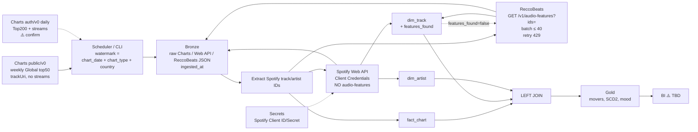

# Spec: Spotify Charts → Web API → ReccoBeats Pipeline (Demo)

**Status:** Draft for implementation (awaiting tool confirmations marked ⚠️)  
**Source research:** [Research – Spotify data sources & ReccoBeats pipeline (demo)](https://app.notion.com/p/Research-Spotify-data-sources-ReccoBeats-pipeline-demo-41a88b8696fa81049c9df55c450ae2d2) (16/11/2026, Asia/Bangkok)  
**Repo:** `spotify-data-pipeline` (greenfield)  
**Audience:** Learning / portfolio demo — not legal advice, not production SaaS

---

## Objective

Build a local **batch data pipeline** that:

1. Ingests Spotify chart rankings (grain: date × chart type × country × track).
2. Enriches track/artist metadata via **Spotify Web API** (Client Credentials) — **without** using locked audio-features endpoints.
3. Enriches audio-feature metrics via **ReccoBeats**.
4. Lands data in a **Bronze → Silver → Gold** (medallion) layout.
5. Supports analytics that degrade gracefully when features / popularity / genres are missing.

**Why:** New Spotify apps cannot use Audio Features / Audio Analysis ([Spotify blog 27/11/2024](https://developer.spotify.com/blog/2024-11-27-changes-to-the-web-api)). ReccoBeats provides proprietary substitutes ([ToS](https://reccobeats.com/docs/documentation/terms-of-service), [audio-features API](https://reccobeats.com/docs/apis/get-audio-features)).

**Success looks like:** One CLI command ingests a chart window, stores raw + curated tables, produces a short Gold report (movers / mood) with explicit `features_found` coverage stats.

---

## Locked decisions (from research §8 — 16/11/2026)

| Source | Role |
|--------|------|
| **Spotify Charts** (`charts-spotify-com-service`) | Ranking grain: `chart_date`, `chart_type`, `country`, rank, (streams if available) |
| **Spotify Web API** | Official metadata (track / artist / album fields still available) |
| **ReccoBeats** | Audio features only (`danceability`, `energy`, `valence`, `tempo`, …) |

**Not on the locked happy path:** kworb, Last.fm, Kaggle 1.2M, Deezer.  
They remain **documented fallbacks** (research §2, §4, §6 v1) if Charts `auth/v0` is unavailable or historical backfill is needed.

> Research §6 (kworb-primary) is an **older proposal**. Implementation follows **§8 / pipeline v2**.

---

## Assumptions I'm making (correct me if wrong)

1. **Language:** Python 3.12+ (matches DE learning path).
2. **MVP chart source:** Charts `public/v0` weekly Global top 50 (unauthenticated) — `streams = NULL`.
3. **Daily Top 200 + streams (`auth/v0`):** out of MVP until Bearer-user access and ToS acceptance are confirmed ⚠️.
4. **Storage MVP:** local filesystem Bronze (JSON/JSONL) + **SQLite** Silver/Gold.
5. **Orchestration MVP:** CLI (+ optional OS cron later). No Airflow/Prefect yet ⚠️.
6. **Secrets:** `.env` locally; never commit. Secret-store product TBD ⚠️.
7. **BI:** deferred; Gold queries printable via CLI / optional notebook ⚠️.
8. **Spotify app mode:** implement **both** batch `?ids=` and single `/{id}` paths; detect which works on the configured Client ID ⚠️.
9. **Scope country:** Global first; multi-country later.

---

## Tech Stack

| Layer | Choice (MVP) |
|-------|----------------|
| Language | Python 3.12+ |
| HTTP | `httpx` |
| Config | `pydantic-settings` + `.env` |
| Storage | `pathlib` Bronze files + SQLite |
| CLI | `typer` or `argparse` |
| Tests | `pytest` + recorded fixtures (no live network in CI) |
| Packaging | `uv` or `pip` + `pyproject.toml` |

---

## Commands

```bash
# Setup
python -m venv .venv
source .venv/Scripts/activate   # Windows Git Bash
pip install -e ".[dev]"

# Run full pipeline for one watermark
python -m spotify_pipeline run \
  --chart-date 2026-11-12 \
  --chart-type weekly_top_songs \
  --country global

# Stages (optional)
python -m spotify_pipeline ingest-charts ...
python -m spotify_pipeline enrich-spotify ...
python -m spotify_pipeline enrich-reccobeats ...
python -m spotify_pipeline build-silver ...
python -m spotify_pipeline build-gold ...
python -m spotify_pipeline backfill-features

# Offline / fixture mode
python -m spotify_pipeline run --offline

# Tests
pytest -q
```

---

## Project Structure

Hybrid layout: keep package `src/spotify_pipeline/` (SPEC), but **tách riêng** theo vai trò từ Notion §9 — clients / models / pipeline / state / analytics không lẫn nhau.

### Layer responsibilities (tách riêng)

| Layer | Được làm | Không làm |
|-------|----------|-----------|
| `clients/` | HTTP I/O tới Charts / Spotify / ReccoBeats; retry 429 | Validate business row; Gold math |
| `models/` | Pydantic fail-fast sau extract (Optional popularity/genres/…) | Movers / mood / SCD2 |
| `pipeline/` | Ingest → enrich → bronze → silver → gold → backfill | Format Telegram/report UI |
| `state/` | Watermark `(chart_date, chart_type, country)` | Gọi API |
| `analytics/` | Đọc Gold → summary / movers / mood report | Copy logic SQL; gọi lại API |
| `scripts/` | Smoke-check local (Spotify / ReccoBeats) | Cloud Run / BQ deploy (hoãn) |

### Tree

```text
spotify-data-pipeline/
  docs/
    SPEC.md
  architecture/
    music-pipeline.png / .drawio / .drawio.zip
  src/spotify_pipeline/
    __init__.py
    cli.py                      # run / backfill / --report / --offline
    config.py                   # .env + settings (batch sizes, paths)
    clients/                    # ← I/O only (tách riêng)
      __init__.py
      http.py                   # shared session, retry / Retry-After
      charts.py                 # public/v0 (+ stub auth/v0)
      spotify_auth.py           # Client Credentials, token ~1h
      spotify.py                # tracks/artists; batch hoặc /{id}
      reccobeats.py             # GET /v1/audio-features?ids= ≤40
    models/                     # ← validate only (tách riêng)
      __init__.py
      chart.py                  # ChartEntry (streams Optional)
      track.py                  # Track, Artist (deprecated fields Optional)
      audio_features.py         # AudioFeatures + features_found
    pipeline/                   # ← orchestration / medallion (tách riêng)
      __init__.py
      ingest_charts.py
      enrich_spotify.py
      enrich_reccobeats.py
      bronze.py
      silver.py
      gold.py
      backfill.py
      run.py                    # 1 cycle: watermark → … → summary
    state/                      # ← watermark only (tách riêng)
      __init__.py
      watermark.py
    analytics/                  # ← read Gold + present (tách riêng)
      __init__.py
      movers.py
      mood.py
      summary.py
  data/
    bronze/                     # gitignored raw JSON
    silver/                     # sqlite / curated
    gold/
  scripts/                      # local smoke only (cloud scripts deferred)
    check_spotify.py
    check_reccobeats.py
  tests/
    fixtures/
      charts_public_v0_weekly.json
      tracks_batch.json
      tracks_single.json
      artists_batch.json
      reccobeats_audio_features.json   # 26/40-style
      reccobeats_batch41_error.json    # status 4004
    test_http_retry.py
    test_reccobeats_batch.py
    test_charts_parse.py
    test_models.py
    test_silver_left_join.py
    test_watermark.py
    test_analytics_summary.py
  .env.example
  .gitignore
  pyproject.toml
  README.md
```

**Hoãn (Notion §9 cloud — không đưa vào cây MVP):** `Dockerfile`, Cloud Run, GCS/BigQuery load, `staging/` NDJSON primary, Telegram alert, rename repo → `spotify-chart-elt/`.

---

## Architecture (pipeline v2)

Primary diagram (locked stack §8 / former Notion `music-pipeline-v2`):

| File | Meaning |
|------|---------|
| [`architecture/music-pipeline.png`](../architecture/music-pipeline.png) | Pipeline diagram |
| [`architecture/music-pipeline.drawio`](../architecture/music-pipeline.drawio) | Editable draw.io source |
| [`architecture/music-pipeline.drawio.zip`](../architecture/music-pipeline.drawio.zip) | Zipped source (Notion export) |



**Watermark:** `(chart_date, chart_type, country)` — one pipeline run = one watermark.

---

## Component breakdown (implementable units)

| # | Component | Path (tách riêng) | Responsibility | Depends on |
|---|-----------|-------------------|----------------|------------|
| C1 | Config / secrets | `config.py` | Load Spotify creds, paths, batch sizes | — |
| C2 | HTTP retry | `clients/http.py` | Shared session; 429 + Retry-After | C1 |
| C3 | Charts client | `clients/charts.py` | Fetch `public/v0`; parse `trackUri`, ranks | C2 |
| C4 | Spotify auth/client | `clients/spotify_auth.py`, `spotify.py` | Token ~1h; tracks/artists; batch hoặc `/{id}` | C2 |
| C5 | ReccoBeats client | `clients/reccobeats.py` | Batch ≤40 `?ids=`; map IDs; 429 | C2 |
| C6 | Models | `models/*` | Validate ChartEntry / Track / Artist / AudioFeatures | — |
| C7 | Watermark | `state/watermark.py` | `(chart_date, chart_type, country)` | C1 |
| C8 | Bronze writer | `pipeline/bronze.py` | Persist raw JSON + `ingested_at` | C3–C5 |
| C9 | Ingest / enrich | `pipeline/ingest_*.py`, `enrich_*.py` | Charts → validate → Bronze; Spotify/RB enrich | C3–C6, C8 |
| C10 | Silver builder | `pipeline/silver.py` | `fact_chart` + dims; **LEFT JOIN only** | C8, C9 |
| C11 | Gold builder | `pipeline/gold.py` | Movers, SCD2 (nice), mood (`features_found=true`) | C10 |
| C12 | Backfill | `pipeline/backfill.py` | Re-query ReccoBeats where `features_found=false` | C5, C10 |
| C13 | Analytics | `analytics/*` | Đọc Gold → report (`--report`); không gọi API | C11 |
| C14 | CLI / run | `cli.py`, `pipeline/run.py` | 1 cycle + exit codes + coverage % | all |
| C15 | Fixtures / offline | `tests/fixtures/` | E2E 26/40 + batch41; `run --offline` | C5–C13 |
| C16 | Tests | `tests/` | Retry, batching, LEFT JOIN, models, watermark | C2–C13 |

---

## Business rules (must implement)

1. **Never call** Spotify `/v1/audio-features`, `/v1/audio-analysis`, `/v1/recommendations`, or related-artists for this stack.
2. ReccoBeats metrics are **proprietary**, not Spotify Audio Features — label `source=reccobeats` everywhere.
3. ReccoBeats calls use **query `?ids=`** with Spotify track IDs. Do **not** put Spotify IDs in path `/:id` (returns 4041).
4. ReccoBeats batch size **≤ 40** (41+ → status `4004`). Dedupe IDs; preserve chart order for reconciliation.
5. Missing ReccoBeats tracks: omitted from `content[]` without failing the batch → set `features_found=false`, **keep chart row**.
6. Silver joins are **LEFT JOIN** — never drop chart rows for missing features / genres / popularity.
7. Honor HTTP **429 + `Retry-After`** for ReccoBeats (and Spotify).
8. Cache / persist raw ReccoBeats + Spotify payloads in Bronze (`ingested_at` required).
9. Do **not** use ReccoBeats search as coverage repair (E2E: wrong remix for chart #1).
10. Deprecated Spotify fields (`track.popularity`, `artist.genres`, `artist.followers`, `artist.popularity`) must be **nullable**; Gold degrades gracefully.
11. Learning/demo only: do not redistribute Spotify/Kaggle dumps; do not scrape `charts.spotify.com` for public/commercial portfolio without renewed ToS review.

---

## Data model (Silver)

### `fact_chart`
| Column | Source | Notes |
|--------|--------|-------|
| `chart_date` | Charts | Part of watermark |
| `chart_type` | Charts | e.g. `weekly_top_songs` |
| `country` | Charts | e.g. `global` |
| `track_id` | Charts `trackUri` | Spotify Base-62 |
| `rank` | `currentRank` | |
| `prev_rank` | `previousRank` | |
| `streams` | `auth/v0` only | NULL on `public/v0` |
| `entry_status` | Charts | optional |
| `ingested_at` | Pipeline | |

**PK / uniqueness:** `(chart_date, chart_type, country, track_id)`

### `dim_track`
| Column | Source | Notes |
|--------|--------|-------|
| `track_id` | Spotify / Charts | PK |
| `track_name`, `duration_ms`, `explicit` | Web API track | |
| `album_id`, `album_name`, `release_date`, `release_date_precision` | `track.album` | No separate `/albums` required for MVP |
| `isrc` | `external_ids.isrc` | Available per Mar 2026 revert |
| `track_popularity` | Web API | Nullable / deprecated |
| `reccobeats_uuid`, `href` | ReccoBeats | |
| Audio feature columns | ReccoBeats | acousticness … valence |
| `features_found` | Pipeline | bool |
| `features_fetched_at` | Pipeline | |
| `source_features` | const `reccobeats` | |

### `dim_artist`
| Column | Source | Notes |
|--------|--------|-------|
| `artist_id` | Web API | PK |
| `artist_name` | Web API | |
| `genres` | `artist.genres` | Deprecated; may be empty |
| `followers` | `followers.total` | May be absent on new Dev Mode |
| `artist_popularity` | Web API | May be absent on new Dev Mode |

---

## API contracts (implementation constraints)

### Spotify
- Auth: `POST https://accounts.spotify.com/api/token` (`client_credentials`), token ~3600s.
- Prefer `GET /v1/tracks?ids=` (max 50) / `GET /v1/artists?ids=` (max 50) when Client ID still allows batch.
- Fallback: `GET /v1/tracks/{id}`, `GET /v1/artists/{id}` for new Dev Mode (post 11/02/2026 limits).
- Albums: use embedded `track.album`; optional `GET /v1/albums/{id}` only if needed.

### ReccoBeats
- Base: `https://api.reccobeats.com`
- Header: `Accept: application/json`
- No API key
- Primary: `GET /v1/audio-features?ids=id1,id2,...` (≤40)
- Optional metadata: `GET /v1/track?ids=...` (≤40)
- On 429: sleep `Retry-After`, retry with capped attempts

### Charts
- MVP: unofficial `public/v0` weekly Top Songs Global (top 50) — no streams.
- ⚠️ `auth/v0` daily Top 200 + streams: confirm Bearer user token lifetime + ToS acceptance before coding.

---

## E2E evidence to encode as fixtures (16/11/2026)

- Sample: 40 weekly Global track IDs → ReccoBeats **26/40** matched on both audio-features and track metadata.
- Top **#1–#6 missing** (new releases lag) — pipeline must keep those ranks with `features_found=false`.
- Matched example: The Killers – Mr. Brightside (`003vvx7Niy0yvhvHt4a68B`) with full feature payload (see research §5).

---

## Gold analytics (MVP)

1. **Coverage report:** `% features_found`, list of missing top-N ranks.
2. **Movers:** rank delta (`prev_rank - rank`) for watermark.
3. **Mood segments:** only rows with `features_found=true` (e.g. energy×valence quadrants) — document thresholds in code comments.
4. **Optional:** popularity vs features scatter — skip/null-safe if `track_popularity` absent.

SCD2 rank history: MVP may store append-only `fact_chart` and compute history by query; formal SCD2 table is nice-to-have.

---

## Code Style

```python
# Good: chunk + preserve order + never fail whole batch on partial misses
def chunked(ids: list[str], size: int = 40) -> list[list[str]]:
    uniq = list(dict.fromkeys(ids))  # dedupe, keep order
    return [uniq[i : i + size] for i in range(0, len(uniq), size)]
```

- Prefer explicit functions over class hierarchies.
- Network I/O only inside `clients/`.
- Pure transforms in `pipeline/` / `analytics/`.
- Type hints on public functions; fail fast on invalid watermark.

---

## Testing Strategy

| Level | What |
|-------|------|
| Unit | ID chunking (41 → 4004 prevention), URI parse, LEFT JOIN semantics |
| Contract | ReccoBeats/Spotify fixture JSON → model mapping |
| Integration (optional local) | Live smoke behind `@pytest.mark.live` |
| Regression | Offline `run --offline` reproduces summary counts from fixtures |

CI: offline tests only.

---

## Boundaries

**Always**
- Persist Bronze raw payloads before Silver transforms.
- LEFT JOIN chart ↔ features.
- Label ReccoBeats provenance.
- Keep secrets out of git.
- Document ToS / unofficial Charts risk in README.

**Ask first**
- Enabling `auth/v0` or kworb HTML scraping.
- Adding cloud warehouse / Airflow / public dashboard.
- Publishing dataset dumps.
- Changing locked stack away from Charts + Web API + ReccoBeats.

**Never**
- Call Spotify audio-features / audio-analysis for this project.
- Use ReccoBeats path endpoints with Spotify IDs.
- Drop chart rows when enrichment misses.
- Claim ReccoBeats numbers equal Spotify Audio Features.
- Commit `.env` or access tokens.

---

## Implementation order

1. Scaffold `pyproject.toml`, config, `.env.example`, folder layout.
2. ReccoBeats client + fixtures from §5 E2E (highest risk learning).
3. Charts `public/v0` ingest → Bronze.
4. Spotify Client Credentials + track/artist enrich → Bronze.
5. Silver tables + LEFT JOIN + `features_found`.
6. Gold summary (coverage + movers + mood).
7. Backfill job.
8. CLI `run` + README (architecture, risks, how to run offline).
9. Optional: auth/v0, BI, scheduler — after ⚠️ checklist below.

---

## Success Criteria

- [ ] `run --offline` completes Bronze→Silver→Gold using fixtures.
- [ ] Live `run` for one weekly Global watermark stores chart rows for **all** returned ranks.
- [ ] ReccoBeats enrichment never exceeds 40 IDs/request.
- [ ] Missing ReccoBeats tracks yield `features_found=false` without dropping `fact_chart` rows.
- [ ] No Spotify audio-features calls in codebase.
- [ ] Deprecated Spotify fields nullable; Gold still runs.
- [ ] README states ReccoBeats AS-IS risk, Charts unofficial/`public/v0` risk, and learning-only scope.
- [ ] `.env.example` documents `SPOTIFY_CLIENT_ID` / `SPOTIFY_CLIENT_SECRET`; no secrets committed.
- [ ] Pytest offline suite green.

---

## Open Questions (blocking / high impact)

1. Spotify Client ID mode: Extended Quota vs Dev Mode old vs Dev Mode new? → batch vs `/{id}`.
2. On that Client ID, are `track.popularity`, `artist.genres`, `followers`, `artist.popularity` still returned?
3. Accept Charts `auth/v0` daily (Bearer user) for streams despite ToS risk, or stay weekly `public/v0` + `streams=NULL`?
4. If no `auth/v0`: stay weekly-only, or revive kworb fallback?
5. Scheduler / secret store / object store / BI product choices.
6. Measured rate-limit thresholds (ReccoBeats + Spotify) — unknown; implement defensive retries.
7. Does the Spotify app owner have Premium (required for current Dev Mode)?

---

## Risks (carry into README)

| Risk | Severity | Mitigation |
|------|----------|------------|
| ReccoBeats coverage gaps (E2E 26/40; top ranks missing) | High | LEFT JOIN + backfill + coverage report |
| ReccoBeats AS-IS / shutdown | High | Bronze cache + offline fixtures |
| Charts unofficial + ToS scrape ban | High | Prefer documented learning scope; avoid public scrape of charts.spotify.com |
| Spotify Dev Mode field/endpoint removals | Medium | Single-ID fallback; nullable fields |
| Rate limits unpublished | Medium | Retry-After, low concurrency, cache |
| Feature fidelity ≠ historical Spotify/Kaggle | Medium | Never claim parity; optional later comparison study |

---

## Change log

| Date | Change |
|------|--------|
| 2026-11-16 | Initial SPEC distilled from Notion research §1–§8 + BA component mapping. Locked stack = Charts + Web API + ReccoBeats (v2). |
