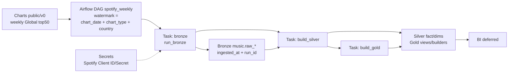

# Spec v2: Spotify Pipeline — Airflow Orchestration (Option B)

**Status:** Draft for implementation — orchestration v2 locked (Phase 0); coding not started  
**Version:** 2.0 (orchestration)  
**Date:** 2026-11-19 (Asia/Bangkok)  
**Audience:** Learning / portfolio demo — not legal advice, not production SaaS  
**Repo:** `spotify-pipeline` (package `spotify_pipeline`)

---

## Relationship to Spec v1

| Doc | Role |
|-----|------|
| [`SPEC.md`](SPEC.md) | **v1** — medallion data product, Bronze Stage 4, Silver C10, Gold C11, CLI-centric orchestration (Assumption #5: CLI + optional OS cron; **No Airflow**) |
| **This file (`SPEC_V2.md`)** | **v2** — **supersedes orchestration / scheduling / weekly automation** decisions only |

**Rule:** Where this document conflicts with v1 on **orchestration**, **v2 wins**.  
Where v2 is silent (HTTP clients, ReccoBeats rules, Silver LEFT JOIN, Gold analytics math, DDL, ToS), **v1 + existing code remain authoritative**.

**Architecture diagrams:**

| File | Meaning |
|------|---------|
| [`architecture/version_1/`](../../architecture/version_1/) | v1 pipeline diagram (CLI / generic scheduler) |
| [`architecture/version_2/music-pipeline-v2.0.png`](../../architecture/version_2/music-pipeline-v2.0.png) | v2 architecture image |
| [`architecture/version_2/music-pipeline-v2.0.drawio`](../../architecture/version_2/music-pipeline-v2.0.drawio) | v2 editable source |

**Related:**
- [`DECISION_ORCHESTRATION_V2.md`](DECISION_ORCHESTRATION_V2.md) — **accepted decision record** (Assumption #5 + Phase 0 locks)
- [`CHECKLIST_SPEC_V2.md`](CHECKLIST_SPEC_V2.md) — **self-verification checklist** khi tự implement v2 (tick theo phase)
- [`CHECKLIST_SPEC_GAPS.md`](CHECKLIST_SPEC_GAPS.md) — gap tracking v1; soft SQ-11 / GQ-8 **superseded for weekly path** by this DAG (see § Migration)

---

## 1. Objective (v2)

Keep the v1 batch medallion pipeline, and add **reliable weekly orchestration**:

1. Run one watermark through **Bronze → Silver → Gold** via Airflow DAG **`spotify_weekly`**.
2. Own **schedule**, **task retries**, and **historical week catch-up** in Airflow (not in Python scheduler code).
3. Reuse existing Python entrypoints: `run_bronze`, `build_silver`, `build_gold` — **no rewrite** of Silver/Gold into Airflow SQL operators.
4. Preserve offline-first CI (`pytest` without live Airflow or live APIs).

**Success looks like (v2):** A manual (then scheduled) Airflow DAG run for watermark W lands Bronze and refreshes Silver + Gold; failures retry from the failed curated task without re-Bronzing by default; ~8 weeks of global weekly songs can be caught up as a full chain later.

---

## 2. What stays vs what changes

### Stays from v1 (unchanged intent)

| Area | v1 Fact carried forward |
|------|-------------------------|
| Sources | Charts `public/v0`, Spotify Web API (no audio-features), ReccoBeats |
| Grain | Watermark `(chart_date, chart_type, country)` — one logical cycle = one watermark |
| SoR | Postgres `music.*` (Supabase); optional FS Bronze dual-write |
| Bronze | Ingest → extract IDs from `raw_charts` → enrich Spotify + ReccoBeats (`run_bronze`) |
| Silver | `build_silver` from Bronze only — **LEFT JOIN**, `features_found` |
| Gold | `build_gold` from Silver only — coverage / movers / mood; formal SCD2 deferred |
| Spotify mode | Single `/{id}` (Q-D=2); batch deferred |
| Country MVP | Global first |
| Business rules | v1 BR #1–#11 (no Spotify audio-features; ReccoBeats `?ids=` ≤40; etc.) |
| C12 | ReccoBeats gap backfill where `features_found=false` — **separate** product; stub OK |
| CLI stages | `ingest-charts`, `enrich-*`, `build-silver`, `build-gold`, `run` (Bronze) remain for local/dev |
| CI | Offline fixtures / pytest; no live network required |

### Changes in v2 (orchestration only)

| Area | v1 | v2 |
|------|----|----|
| Orchestrator | CLI (+ optional OS cron); No Airflow | Airflow DAG **`spotify_weekly`** |
| Weekly “done” | Manual CLI chain (and soft SQ-11/GQ-8 into `run`) | DAG all-green: Bronze + Silver + Gold |
| Wire Silver/Gold | Soft SQ-11 / GQ-8 into `run` | **DAG tasks**; **`run` stays Bronze-only** |
| Retries | Client HTTP/DB retries | Client retries **+** Airflow task retries |
| Historical weeks | Manual `--chart-date` | Airflow week catch-up (full chain) |
| Airflow install | N/A | Docker / separate env — **not** default `pyproject` deps |

---

## 3. Non-goals (v2)

- Merge **C12** `backfill-features` into DAG `spotify_weekly`.
- Cloud warehouse, public BI dashboard, Prefect.
- Rewrite Silver/Gold as Airflow SQL / native Transfer operators.
- Require live Airflow (or live Charts/Spotify/ReccoBeats) for default CI.
- Grow `pipeline/run.py` into Silver/Gold (SQ-11 / GQ-8 **cancelled for weekly path**).
- Daily Charts `auth/v0` / multi-country (still out unless separately decided).
- Inventing **Q8a** week-boundary weekday before it is locked.

---

## 4. Assumptions (v2)

1. **Language:** Python 3.12+ (unchanged).
2. **MVP chart source:** Charts `public/v0` weekly Global top 50 — `streams = NULL` (unchanged).
3. **Daily Top 200 + streams (`auth/v0`):** still out of MVP.
4. **Storage:** Postgres `music.*` SoR (unchanged).
5. **Orchestration (REPLACES v1 Assumption #5):**
   - Primary weekly orchestrator = **Apache Airflow** DAG `spotify_weekly`.
   - CLI remains for local/dev/repair/offline Bronze.
   - OS cron is **not** the v2 happy path.
   - Prefect is out of scope.
6. **Secrets:** `.env` locally / injected into Airflow worker env; never commit. Secret-store product still TBD.
7. **BI:** still deferred.
8. **Spotify app mode:** single-ID MVP (unchanged).
9. **Scope country:** Global first; catch-up MVP = **global only** (Phase 0 Q10).
10. **Airflow packaging:** Docker Compose or separate env (**Q11**). Airflow package version pin = implementer choice — **Recommendation only:** pin a current Airflow 2.x in the Airflow image/compose file, not in default app deps.

---

## 5. Phase 0 locked decisions (Fact — do not reopen)

| ID | Lock | Meaning |
|----|------|---------|
| **Option B** | Locked | DAG = Bronze (`run_bronze`) → `build_silver` → `build_gold` |
| **Q1=A** | All green | DAG success = Bronze **and** Silver **and** Gold success |
| **Q2=A** | Clear from fail | Silver/Gold fail after Bronze OK → retry/clear **from failed task only**; **no re-Bronze by default** |
| **Q3=A** | Catch-up full chain | Week catch-up always Bronze → Silver → Gold |
| **Q4=A** | Two curated tasks | Separate `build_silver` then `build_gold` tasks |
| **Q5=A** | `run` Bronze-only | Do **not** implement SQ-11/GQ-8 inside `run.py`; DAG owns wiring |
| **Q6=A** | No Gold soft_fail | Gold failure fails the task / DAG run |
| **Q7=C→A** | Manual then schedule | Stage 1: **manual-only** until Phase 4 green; Stage 2: enable weekly schedule. Default proposal: **Mon 09:00 `Asia/Bangkok`** unless overridden later |
| **Q8=A** | Logical date → chart_date | `chart_date` derived from Airflow logical / data interval via fixed week-boundary rule |
| **Q9=B** | Append Bronze | Re-run appends new Bronze rows with new `run_id`; consumers use **latest** |
| **Q10=A** | Catch-up scope | `country=global` + `chart_type=weekly_top_songs`; about **8 weeks** |
| **Q11=A** | Install/CI | Airflow in Docker/separate env; **not** default `pyproject` deps; CI = pytest offline only |

**Traceability:** `Option B | Q1=A Q2=A Q3=A Q4=A Q5=A Q6=A Q7=C→A Q8=A Q9=B Q10=A Q11=A`

---

## 6. Architecture (ORCH = Airflow)



**Task graph (locked):**

```text
bronze (run_bronze)
  >> build_silver
  >> build_gold
```

- HTTP I/O only in **bronze** (and its callees).
- **build_silver** / **build_gold** = DB-only builders (v1 Fact).

See also: [`architecture/version_2/music-pipeline-v2.0.png`](../../architecture/version_2/music-pipeline-v2.0.png).

---

## 7. Components

### Unchanged app components (v1 C1–C13, C15–C16)

Reuse as implemented. Highlights:

| # | Component | v2 note |
|---|-----------|---------|
| C7 | Watermark | Still `(chart_date, chart_type, country)`; DAG must construct this |
| C8–C9 | Bronze / enrich | Invoked via `run_bronze` |
| C10 | Silver | Invoked via DAG task → `build_silver` |
| C11 | Gold | Invoked via DAG task → `build_gold` |
| C12 | Feature backfill | **Out of DAG**; keep separate naming from week catch-up |
| C14 | CLI / `run` | **Bronze-only** entrypoint + local tools; **not** weekly orchestrator |
| C17 **(new)** | Airflow DAG `spotify_weekly` | Schedule (stage 2), retries, catch-up, task wiring |

### Suggested layout (Recommendation — path names not product-locked)

```text
dags/
  spotify_weekly.py          # Airflow DAG only (thin wrappers)
docker/                      # or compose at repo root — Airflow stack (Q11)
docs/spec/SPEC.md            # v1
docs/spec/SPEC_V2.md         # this file
src/spotify_pipeline/        # unchanged package ownership of builders
```

---

## 8. Watermark mapping (Q8 + Q8a LOCKED 26/11)

**Locked (Q8=A):** For each DAG run, derive `chart_date` from Airflow **logical date / data interval** using a **fixed week-boundary rule**.

**Locked defaults for scheduled + catch-up MVP (Q10=A):**

- `chart_type = weekly_top_songs`
- `country = global`

**Q8a — LOCKED 26/11 (Chubby):** `chart_date` = **Thứ Năm gần nhất trước** `data_interval_end` (run Mon 09:00 → Thứ Năm cách 4 ngày, ví dụ Mon 30/11 → Thu 26/11). Lý do: Charts public/v0 vẫn live tuần trước vào sáng Thứ Năm, nên chart của tuần đang chạy chưa chắc đã publish. Cách xác minh: P5-02 Verify.

Mô tả trước khi lock (giữ làm bối cảnh):

> Exact formula mapping Airflow data interval → `chart_date`  
> (e.g. which weekday represents the Spotify weekly chart date: Thursday, Monday/ISO week start, `data_interval_end.date()`, etc.)

Before the Q8a lock (historical, superseded):

- Manual DAG triggers **may** pass explicit `chart_date` via DAG params / conf (**Recommendation** for Phase 3 bootstrap).
- Scheduled catch-up week enumeration **must not** be hard-coded to a guessed weekday.

**Watermark object:** continue using `spotify_pipeline.state.watermark.Watermark`.

---

## 9. Retry, failure, and Bronze append semantics

### Dual retry layers

| Layer | Scope |
|-------|--------|
| HTTP client (`clients/http.py`) | 429 + `Retry-After` (v1 BR #7) |
| Airflow task retries | Transient task failures (counts/delays = implementer defaults unless later locked) |

**Recommendation:** Keep Airflow Bronze retries modest to avoid amplifying API pressure on top of client retries.

### Failure policy (locked)

| Case | Behavior |
|------|----------|
| Any of Bronze / Silver / Gold fails after retries | DAG run **failed** (Q1=A, Q6=A) |
| Bronze OK, Silver fails | Clear/retry **Silver** (then Gold); **do not** re-run Bronze by default (Q2=A) |
| Silver OK, Gold fails | Clear/retry **Gold** only (Q2=A) |
| Operator wants fresh Bronze | Explicit re-trigger of Bronze task / full manual redo — not the default recovery path |

### Bronze append (Q9=B)

- Re-running Bronze for the same watermark **appends** a new raw payload with a **new `run_id`** / new `ingested_at`.
- Silver/Gold **must consume latest** Bronze for that watermark (aligned with existing `fetch_latest_*` / `ORDER BY ingested_at DESC` behavior in Silver).
- **No** “skip if Bronze done” gate (that was Q9=A — rejected).

### Week catch-up ≠ C12

| Term | Meaning |
|------|---------|
| **Week catch-up** | Airflow backfill/catch-up of historical **watermarks** (full chain) |
| **C12 feature backfill** | Re-query ReccoBeats where `features_found=false` — **not** in this DAG |

---

## 10. Catch-up & schedule (phased)

### Delivery phases (locked sequencing)

| Stage | Trigger | Scope |
|-------|---------|--------|
| **D1 — Manual** | Operator triggers DAG / tasks | Prove one watermark all-green (Phase 4 gate) |
| **D2 — Schedule** | After D1 green; enable timetable | Default proposal **Mon 09:00 Asia/Bangkok** (Q7); confirm/override at enable time |
| **D3 — Catch-up** | After D1 (**Recommendation:** after D2 or with care under D1) | ~**8 weeks**, `global` + `weekly_top_songs`, **full chain** each week (Q3, Q10) |

### Catch-up rules (locked)

- Each caught-up week runs **Bronze → Silver → Gold**.
- Same watermark mapping rules as scheduled runs (Q8 + Q8a when closed).
- Bronze append semantics apply if a week is re-processed (Q9).

---

## 11. Commands & operator surfaces

### Still valid (local / repair / CI)

```bash
# Bronze-only cycle (C14 — unchanged role)
python -m spotify_pipeline run --chart-date YYYY-MM-DD --chart-type weekly_top_songs --country global

python -m spotify_pipeline build-silver --chart-date ... --chart-type weekly_top_songs --country global
python -m spotify_pipeline build-gold   --chart-date ... --chart-type weekly_top_songs --country global

pytest -q
```

### v2 primary (after Airflow env up)

- Trigger / clear tasks on DAG **`spotify_weekly`** in Airflow UI or CLI.
- Do **not** expect `pip install -e .` alone to install Airflow (Q11).

### Explicitly not the weekly orchestrator

- OS cron calling `run` (v1 optional path) — superseded for v2 happy path.
- `run` growing into Silver/Gold.

---

## 12. Migration from v1 C14 / soft SQ-11 / GQ-8

| v1 item | v2 disposition |
|---------|----------------|
| `run` / `run_bronze` | **Keep** as Bronze task implementation + local CLI |
| Soft **SQ-11** (wire `run` → Silver) | **Superseded** — use DAG `build_silver` task |
| Soft **GQ-8** (wire `run` → Gold) | **Superseded** — use DAG `build_gold` task |
| Success criteria “one CLI does Bronze→Silver→Gold” | **Split:** offline/CLI for builders; **weekly done** = DAG all-green |
| Assumption #5 “No Airflow” | **Superseded** by this SPEC v2 for the weekly path |
| README “Airflow out of MVP” | Update when implementing / in Phase 1 doc sync |

---

## 13. CI / packaging boundary (Q11)

| Surface | Policy |
|---------|--------|
| Default app install (`pyproject` / `.[dev]`) | **No** Airflow dependency |
| Airflow runtime | Docker Compose **or** separate virtualenv/image |
| Default CI | `pytest` offline only — **no** live Airflow cluster |
| Optional DAG parse smoke | Out of default CI unless added later as isolated non-blocking job (**not required** by Phase 0) |

---

## 14. Non-functional requirements

| NFR | v2 expectation |
|-----|----------------|
| Reliability | Airflow task retries + client 429 handling; all-green definition |
| Security | Secrets not in git; worker env injection |
| Operability | Manual-first, then schedule; clear-from-failed-task runbook |
| Performance | Catch-up ~8 weeks full chain — expect API + DB load; prefer serial/low parallelism (**Recommendation**) |
| Compliance / ToS | Same learning-demo constraints as v1; catch-up increases Charts `public/v0` call volume |

---

## 15. Risks

| Risk | Severity | Mitigation |
|------|----------|------------|
| Q8a unset → wrong `chart_date` | High | Mark OPEN; use explicit params until locked |
| Dual retries → rate-limit storms | Medium | Modest Airflow retries; honor Retry-After |
| Append Bronze without latest reads | Medium | Keep/verify Silver `fetch_latest_*` |
| Catch-up cost (8 × full chain) | Medium | Run after Phase 4 green; monitor API errors |
| Docs drift (v1 says no Airflow) | Medium | SPEC_V2 + README sync in Phase 1/7 |
| Confusing week catch-up with C12 | High | Naming + non-goals |

---

## 16. Open questions

| ID | Question | Status |
|----|----------|--------|
| **Q8a** | Exact week-boundary day/formula: Airflow data interval → `chart_date` | **LOCKED 26/11** — Thứ Năm gần nhất trước `data_interval_end` (§8) |
| **Q7-stage2** | Confirm or override **Mon 09:00 Asia/Bangkok** when enabling schedule | Open until schedule enable |
| Secret-store product | Still TBD from v1 | Open |
| Airflow exact version pin | Image/compose pin | **Recommendation** at implement time — not product-locked |

---

## 17. Implementation plan (docs before code)

1. **Phase 1 — Docs:** Land this `SPEC_V2.md` + [`CHECKLIST_SPEC_V2.md`](CHECKLIST_SPEC_V2.md); note v1 Assumption #5 superseded for weekly path; pointer from README/`SPEC.md`.
2. **Phase 2 — Airflow skeleton:** DAG id `spotify_weekly` + Docker/separate env (no default pyproject Airflow).
3. **Phase 3 — Bronze task:** Call `run_bronze`; watermark from params and/or Q8a when closed.
4. **Phase 4 — Curated tasks:** `build_silver` >> `build_gold`; prove **all green** on one watermark (manual).
5. **Phase 5 — Schedule then catch-up:** Enable weekly timetable (Q7); then ~8-week full-chain catch-up (Q3/Q10) with append semantics (Q9).
6. **Phase 6 — CI:** Ensure default pytest stays offline-only.
7. **Phase 7 — Runbook:** Clear-from-failed-task; C12 naming; architecture v2 link.

**Gate:** Do not start Phase 5 schedule/catch-up before Phase 4 all-green (honors Q7).

---

## 18. Acceptance criteria

### AC-V2-1 — Spec relationship

**Given** v1 and v2 docs  
**When** orchestration behavior is interpreted  
**Then** Airflow Option B in this file overrides v1 “No Airflow” / CLI-only weekly orchestration.

### AC-V2-2 — Manual full chain

**Given** Airflow env (Docker/separate) and DAG `spotify_weekly`  
**When** operator manually runs one watermark  
**Then** tasks `bronze` → `build_silver` → `build_gold` succeed using existing Python builders.

### AC-V2-3 — Failure recovery

**Given** Bronze succeeded and Silver or Gold failed  
**When** operator clears/retries  
**Then** recovery starts at the failed curated task without re-Bronzing by default.

### AC-V2-4 — Success definition

**Given** any task in the chain failed after retries  
**When** DAG run completes  
**Then** the DAG run is not considered successful (no Gold soft_fail).

### AC-V2-5 — `run` boundary

**Given** CLI `run`  
**When** invoked  
**Then** it remains Bronze-only (no SQ-11/GQ-8 growth).

### AC-V2-6 — Catch-up

**Given** Phase 5 catch-up enabled  
**When** ~8 global `weekly_top_songs` weeks are processed  
**Then** each week runs full Bronze→Silver→Gold and is not labeled as C12 feature backfill.

### AC-V2-7 — CI

**Given** default CI  
**When** tests run  
**Then** pytest passes offline without installing/running Airflow from default app deps.

### AC-V2-8 — Q8a

**Given** Q8a still OPEN  
**When** scheduled `chart_date` mapping is implemented  
**Then** implementers must not invent a weekday; either wait for lock or use explicit DAG params only.

---

## 19. Business rules (v2 additions)

Carry forward all v1 business rules. **Add:**

12. Weekly automated path is DAG `spotify_weekly` Option B (Bronze → Silver → Gold).
13. DAG success requires all three tasks green; Gold does not soft_fail.
14. Default recovery after Bronze success does not re-execute Bronze.
15. Week catch-up is full chain and is **not** C12.
16. Bronze re-processing appends new `run_id`; curated layers read **latest**.
17. Airflow is not a default application dependency; CI stays offline pytest.

---

## 20. Changelog

| Date | Change |
|------|--------|
| 2026-11-19 | **SPEC v2** created: Airflow Option B + Phase 0 Q1–Q11 locks; supersedes v1 orchestration Assumption #5 for weekly path; Q8a left OPEN; C12/warehouse/BI/SQL-rewrite out of scope. |
| 2026-11-19 | Phase 1: decision record [`DECISION_ORCHESTRATION_V2.md`](DECISION_ORCHESTRATION_V2.md); v1 Assumption #5 rewritten to Airflow lock. |

---

## Appendix A — Quick reference for developers

```text
DAG:        spotify_weekly
Tasks:      bronze(run_bronze) >> build_silver >> build_gold
Success:    all green
Recover:    clear from failed curated task
Catch-up:   full chain; global weekly_top_songs; ~8 weeks
Bronze I/O: append run_id; latest wins downstream
run.py:     Bronze-only forever under this SPEC
Airflow:    Docker/separate env; not in default pyproject
CI:         pytest offline only
OPEN:       Q8a week-boundary day
```
